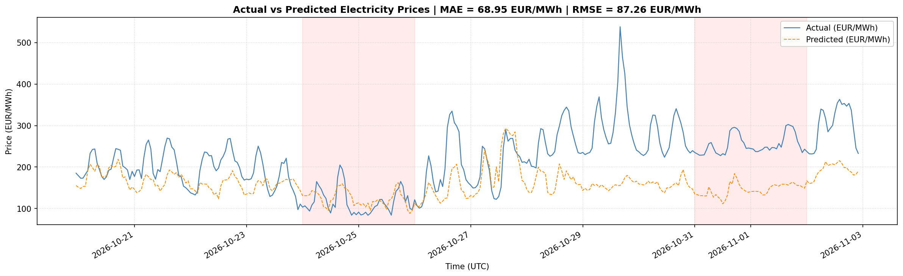
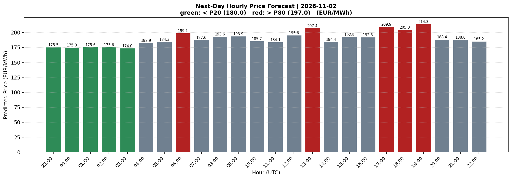
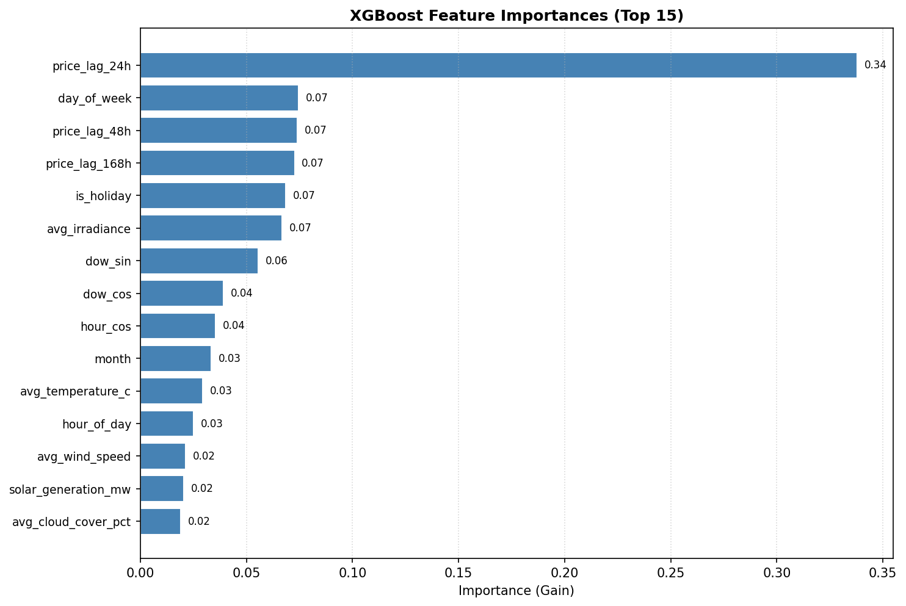
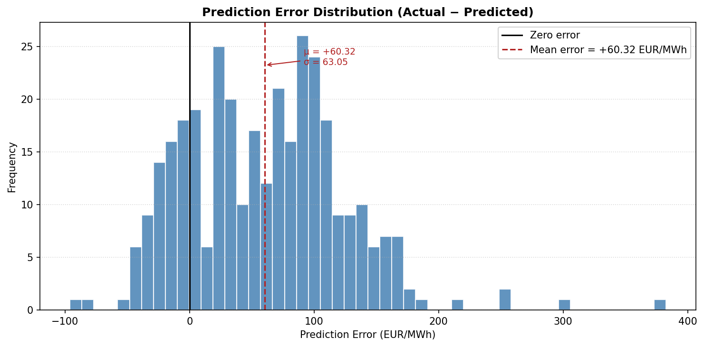
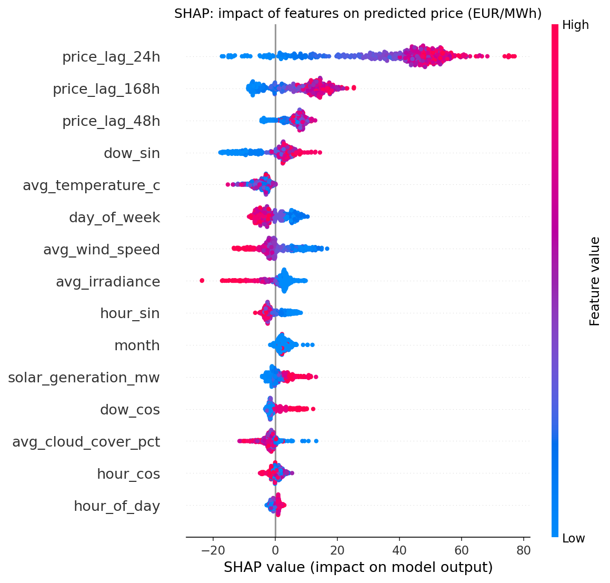

# Evaluation Results

> Generated by `python scripts/run_pipeline.py --mode full`. Figures are produced by
> [`scripts/generate_results_plots.py`](../scripts/generate_results_plots.py).

## Setup

| Item | Value |
|------|-------|
| Target | OTE-CR day-ahead price, hourly average (EUR/MWh) |
| Price history | 2025-11-01 → 2026-11-02 (real OTE data) |
| Weather | Open-Meteo archive, mean of Praha / Brno / Ostrava / Plzeň |
| Generation (solar / wind) | **synthetic** (no ENTSO-E token configured) |
| Model | XGBoost, early stopping, version `1.0.0` |
| Backtest | Train strictly on data **before** the last 14 days, predict those 14 days |

## Hold-out metrics (336 hours, 2026-10-20 → 2026-11-02)

| Metric | Value |
|--------|-------|
| MAE | 68.9 EUR/MWh |
| RMSE | 87.3 EUR/MWh |
| MAPE | 28.5 % |
| Directional accuracy | 62.7 % |

Reading the numbers: the hold-out window contains a price level shift (late-October
prices rise above 250 EUR/MWh) that the model has not seen, so it under-predicts the
level while following the intraday shape (see Figure 1). Expect better numbers with a
real ENTSO-E token (actual wind/solar), gas/CO₂ price features and periodic retraining.

## Figures

### 1. Actual vs. predicted (hold-out)

### 2. Forecast for the next (not yet published) delivery day

### 3. Feature importance

### 4. Error distribution

### 5. SHAP – how factors move the price
High solar irradiance (`avg_irradiance`, red) pushes the predicted price down, as expected.

